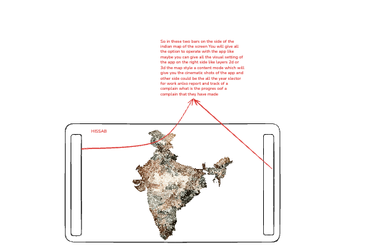
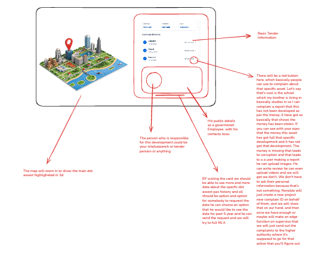

# Three-screen Hisaab blueprint — decisions for the owner

11 October 2026. Status: questions and interpretation, awaiting answers. No rebuild implementation is authorized by this document alone.

## Original sketches

The small annotations are interpreted below rather than treated as an exact transcription.

## Understanding to confirm

1. **India:** a beautiful interactive map with narrow control rails; data panels remain out of the way until requested.
2. **State/locality:** choose a state, see its recorded development funding and purposes, then explore districts and local areas.
3. **Asset:** focus on the location in 3D and show a scrollable receipt with money, dates, sources, responsible parties and a report button.

Sources, person details, reporting and case tracking can open as panels/sheets inside these three public views. The private owner review console remains separate.

Reuse the existing map, asset catalogue, funding data model, receipt/source structure, private reports, tracking, owner review and MFA. Keep records and publication history intact.

## Current implementation and evidence boundary

Existing foundations include Mapbox terrain/camera controls, the preserved 812,976-location reference catalogue, independent map layers, 36-state Funding Atlas, eleven financial years, distinct money measures, source-backed funding facts, project receipt components, private photograph observations, downloadable complaint/RTI drafts and private case tracking.

The sketch adds a focused three-view experience, custom relief rendering, clearer locality navigation, asset-specific 3D highlighting, richer responsible-party records and an operational complaint/escalation process.

The historical locations currently have no approved project-payment links. Most do not have verified building footprints or asset photographs. Existing private report storage is not official complaint submission. Photographs are supported; direct video upload is not implemented. Prepared complaint drafts are not sent automatically. Responsible-person profiles and complete financial histories cannot be populated without evidence.

The layout can be built while these gaps remain explicit. Unknown amounts cannot become zero or illustrative finance in the working product. The source/accounting and review rules remain in force.

## Questions

### Three views and appearance

1. Are these exactly three public views—India, state/locality, and asset—with sources, person details, complaints and tracking opening inside them? Recommendation: yes; retain the private admin console separately.
2. What belongs in each thin side rail? My proposal: left for Explore/Funding/Projects; right for search, year, map appearance and My reports. Please correct this mapping against the sketch.
3. Which landscape direction should the working map follow: the new sculpted relief concepts or a realistic satellite/terrain map with subtler 3D? Recommendation: sculpted relief for the national overview, geographic detail when close.
4. Should first entry show only the map and collapsed controls, with both dots and money hidden until a choice? This matches the earlier requested clean entrance.
5. Once a state is chosen, should the map focus on it and open its card automatically? Recommendation: yes, with a clear return to India and the same saved filters.
6. On phones, may the side rails become a compact toolbar and the cards become bottom sheets? Recommendation: yes, keeping the same three views.
7. Which languages must work at launch? Recommendation: English and Hindi only if the full interface, programme names and evidence labels can be translated consistently; otherwise choose the required launch language explicitly.

### State money and locality navigation

8. Should a state's card describe funding its government received, development expenditure physically located in the state, or both in separate sections? Direct Union works are not necessarily transfers received by the state.
9. Does launch include Union funding, state-funded work and jointly funded programmes, or start with acquired Union evidence and clearly marked state-data gaps? Recommendation: separate each channel and its share; never add a Union transfer again inside a state-funded total.
10. Which amount should lead the card: allocated, released, or reported spent? Recommendation: let the selected measure lead and keep the other measures beside it; do not call all three paid.
11. Which purposes must have dedicated filters at launch? Proposed list: education, health, roads/transport, water/sanitation, housing, agriculture, energy, employment/rural development and disaster response/mitigation.
12. Which path should locality navigation follow: state → district → municipality/panchayat → ward/village → asset, or a constituency-based path? Recommendation: administrative geography, with constituencies as a separately labelled layer if needed.
13. When financial records lack an exact project location, should they remain in the state/programme card rather than receive a map dot? Recommendation: yes; show available facts and the missing location.

### Dots and the asset card

14. Should an area initially show every historical reference location, only projects with reviewed financial evidence, or both with visibly different layers? Recommendation: reviewed projects first; preserve the full historical catalogue as an optional layer.
15. If a historical dot has no linked payments, should opening it show its known asset details and explicit missing financial stages? Recommendation: yes, with a Request records action.
16. For 3D asset highlighting, is surrounding real terrain plus a location ring acceptable when the exact building shape is unavailable? Recommendation: show an exact footprint only when supported; label any illustrative building model as illustrative.
17. If a school or hospital has several funded works across different years, should each work have its own receipt beneath the institution? Recommendation: yes—keep construction, repairs and later additions separate.
18. What must be visible before scrolling? Proposed order: name/location/purpose; approved, contracted and paid figures; latest recorded status; timeline. Dates, recipients, deductions, source documents, photographs and older work history follow below.
19. Should original documents open inside a source viewer, in another browser tab, or offer both? Recommendation: in-app source details with the original document link available.

### Responsible parties and their history

20. Should the card list all documented roles—funding department, executing authority, engineer, contractor and elected representative—or one primary responsible party? Recommendation: separate roles; a minister/MLA is not automatically the contractor or payment recipient.
21. What fields do you want in a person's panel? Proposed scope: sourced name, official role, relevant tenure, office contact, associated works and documented role in this project.
22. I read the sketch as asking for previous work, complaints and corruption-related history. Is that correct, and is the intended period five years? Recommendation: show sourced audit findings and recorded cases with their status; keep citizen allegations, pending cases and proven findings distinct, and do not infer misconduct from association.

### Reports, submission and escalation

23. Should the red action say Report a problem or Report corruption? Recommendation: Report a problem, with choices such as unfinished work, poor quality, missing facility, conflicting records and other concerns.
24. Must a person sign in to report, or can they use a private tracking link? Should reports be private initially or public after review? Recommendation: private first, with deliberate consent and review before public display.
25. Do you need video uploads at launch as well as photographs and documents? Recommendation: support bounded uploads only after confirming storage capacity; define file limits and whether originals can be shared with an authority.
26. Should Hisaab staff review and forward reports, should the citizen submit the prepared packet themselves, or should both routes exist? If Hisaab forwards it, whose account/team is responsible for review and sending?
27. Which events should tracking show? Proposed sequence: received by Hisaab → evidence reviewed → forwarded → official acknowledgement → response → resolution. Recommendation: require evidence of forwarding/acknowledgement; keep Hisaab's case ID separate from the government's registration ID.
28. When does escalation happen, who approves it, and what counts as resolution? Recommendation: configurable follow-up dates, owner-reviewed escalation and separate authority-reported versus citizen-confirmed resolution. Court proceedings remain a separately reviewed future action rather than an automatic result of pressing the report button.

### Delivery and acceptance

29. Which real state and real asset should serve as the acceptance example for all three views? Recommendation: choose the strongest documented project, not a fictional demonstration or a complete-looking historical dot without payment evidence.
30. Is the deadline still 6 AM IST on 12 October, or does the requested 12-hour build window replace it? Also confirm whether the immediate deliverable is local review or a public deployment after acceptance checks.

## Defaults preserved from the accepted plan

- Use existing code; preserve historical dots and sources.
- Funding years remain FY 2016–17 through FY 2026–27 unless explicitly changed.
- Sanction, contract, release, cumulative expenditure and individual payment remain distinct.
- Maintenance exclusions, mixed/unresolved amounts, disaster categories and accounting boundaries remain visible.
- No invented state splits, project geography, recipients, completion evidence or payment dates.
- Missing records remain unknown; they do not mean zero spending.
- Private evidence stays private; publication requires the existing owner/evidence/MFA decisions.
- The Three.js concept is a visual target to prototype, not a verified terrain dataset or a performance guarantee.

## Answer format

Reply using question numbers. For any recommendation that fits, say use the recommended default. Answers will update the main rebuild document before implementation. Scope and acceptance will distinguish completed interface behaviour from incomplete financial evidence.
