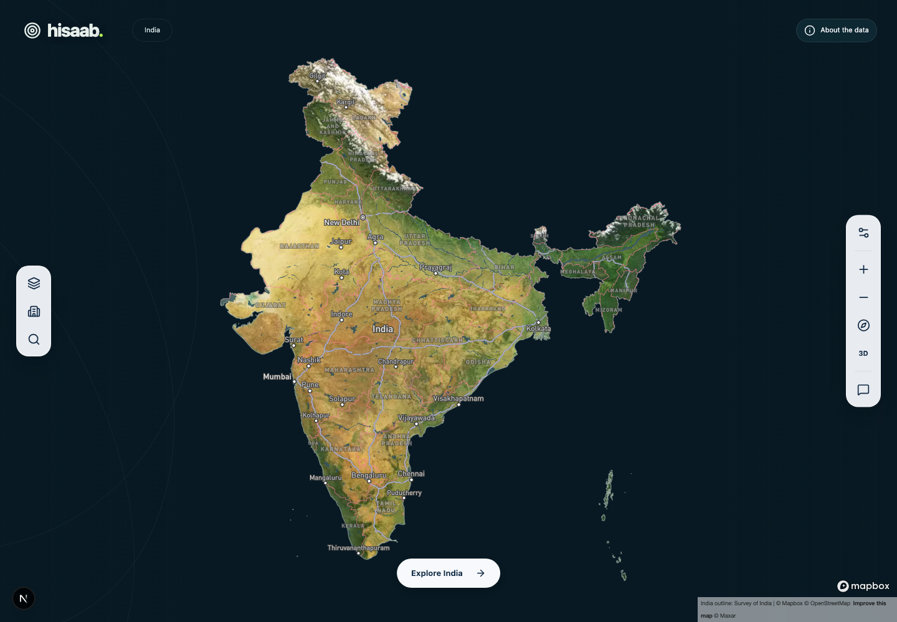
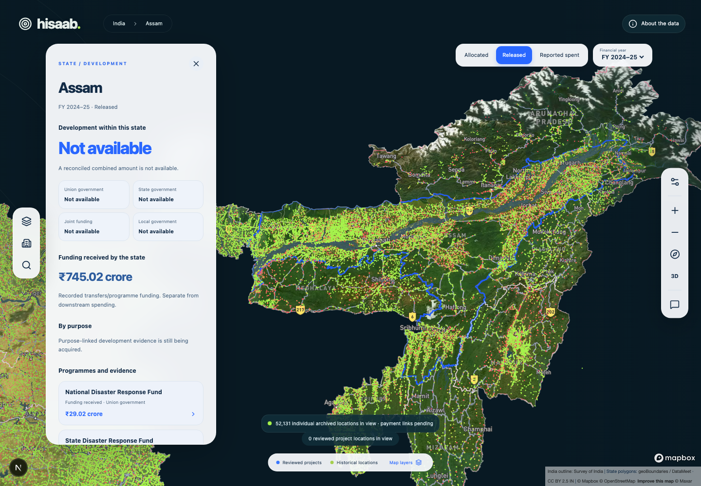
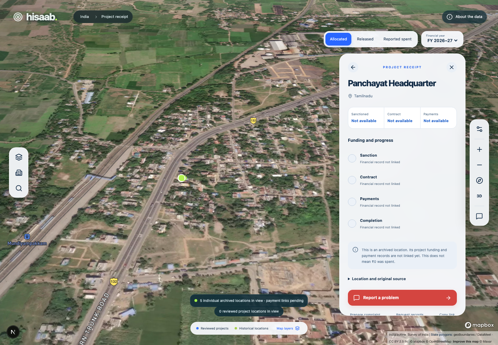
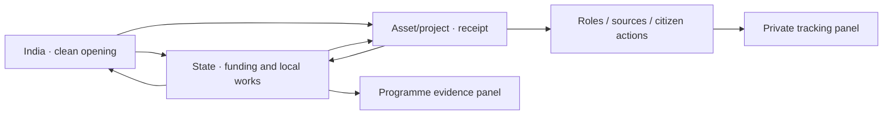
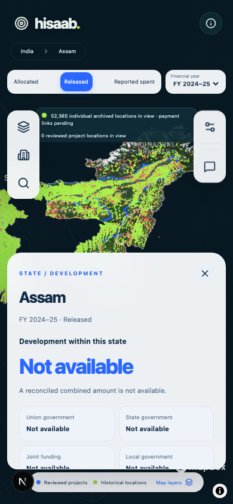

# Hisaab: three-screen rebuild

Owner-approved direction, implemented 11 October 2026. Reuses the existing catalogue, review controls, source records and private reporting. The redesign changes presentation and intake; it does not manufacture missing financial evidence.

## Screen 1 — India

The opening fills the viewport with India’s satellite landscape, sourced terrain, coasts and islands. Its surrounding space uses a dark navy background and restrained contour arcs. Hisaab, collapsed control rails and Explore India are visible. Money, dots, financial years and cards remain hidden until interaction.

Click a state directly, choose Explore India, or zoom toward local detail. Exploration reveals year and money stage controls and three independent layers: reviewed development projects, historical locations and funding colours. Searchable state/project/historical lists preserve access when the map cannot render. Initial hiding does not delete any records.

Mapbox owns the geographic camera, satellite imagery and terrain. Three.js supplies the selected-location halo in the same WebGL canvas. The actual satellite/DEM geography supplies the landscape; no invented model of a school or hospital replaces its original coordinate. Terrain is shown at 1× elevation, with an optional perspective control. The country outline is attributed to Survey of India; state polygons are the documented community boundary edition pending authoritative replacement.

## Screen 2 — State

Selection focuses the camera on the state and opens a card. On mobile this is a scrollable bottom sheet; the map remains above it. The eleven financial years run from 2016–17 through 2026–27, independently of historical geography.

The card shows:

- Development within the area, with Union/state/joint/local contributions.
- A combined development figure only where documentary non-overlap is established.
- Funding received by the state, separately from downstream spending.
- Purpose and programme records, exact amounts, period, source cutoff, accounting basis, instrument and clickable originals.
- District/locality exploration from the reviewed registry and the reviewed project list.
- Explicit missing coverage. Unavailable is never displayed as ₹0.

The current reviewed funding subset is disaster funding. Existing Union transfers are shown as received funding; they are not relabelled as completed schools, hospitals or contractor payments. New school/health/infrastructure records enter through the private intake/review pipeline.

A programme opens evidence and funding history inside a panel. Allocated, released and reported-spent views are separate. National programme facts lacking a reviewed state allocation remain explicitly unassigned. No national total is distributed between states by guesswork.

## Screen 3 — Asset or project receipt

Click a reviewed project or historical dot, or open its list item/deep link. The same map remains underneath. A sourced alignment or coordinate is highlighted, and the camera moves toward the site.

A reviewed project card supports sanction, contract, dated payments, recipient, amount basis, transaction/reference and source records; completion is reported or certificate-backed. Documented agencies, contractors and official roles open person/organisation evidence panels. Five-year history requires an exact official identity or a documented crosswalk; name-only matching is rejected. Site images and person photographs are optional and require source evidence.

A historical card has its actual source ID, coordinate, original geometry, edition and hash. Financial stages remain unlinked until a reviewed project connection exists. One asset can have multiple officially connected projects. Missing finance is explained rather than replaced with a fabricated payment card.

The 812,976 historical records are retained, including co-located locations. Overlapping pixels open a chooser of separate identities. Hosted archives preserve every point at encoded zooms 0–9 and overzoom at street scale. Vector coordinates are quantized for drawing at extent 65,536; receipts preserve exact original coordinates and geometries. This drawing representation is not a certified building footprint or a current asset inventory.

## Panels, navigation and motion

These are exactly three public exploration screens. Sources, programme/person evidence, observations, complaint/RTI drafts and tracking open inside them. `/spending` redirects into the map; legacy funding links remain usable. State/asset deep links, browser Back and retained year/stage/purpose selections are implemented. Private owner pages remain separate.

Apple design principles guide typography, contrast, immediate press feedback, interruptible spring transitions and spatial continuity. Reduced motion disables camera/decorative movement. Reduced transparency uses opaque surfaces; increased contrast strengthens controls. Mobile rail targets are 44 px. Dialogs contain keyboard focus and restore it on close; list navigation remains available without WebGL.

## Citizen workflow

Observation → private case → evidence → reviewed draft → permitted official channel → documentary acknowledgement → tracked response.

Private photographs preserve encrypted originals and safe previews. PDFs preserve encrypted original bytes. MP4/WebM videos are encrypted before upload in resumable signed chunks, with checksum/file-signature checks, private playback/range access and deletion. Up to three videos of 25 MB each; upload pause/resume works in the same open panel within the two-hour authorization. Refreshing the page does not preserve an unfinished upload.

Complaint routing records the jurisdiction, acceptance policy and expiry. CPGRAMS requires citizen portal filing; it is not an email filing route. Hisaab email sending remains disabled until a dedicated sender is configured. An accepting email route also needs citizen consent for the exact text, live MFA owner review and durable dispatch protection. Transport acceptance is not official registration. Owner acknowledgement requires a preserved document from that same case, reference, date and explicit review.

## Data and owner infrastructure

Collectors return `hisaab-intake/1` packages and unchanged originals. Structural and semantic validation checks source hashes/URLs, units, exact identifiers, allocations, reversals, jurisdiction and coverage. Originals and packages stay private. Separate audited owner decisions classify and publish facts; missing stages remain missing. MFA has not been weakened.

Withdrawing a source's approved status, original licence or permission review withdraws affected project snapshots and funding publications, including role/media evidence. Restoring rights requires a new explicit publication decision.

Read [collector contract](data-acquisition-contract.md), [short data brief](data-needed-brief.md), [prepared state/UT jobs](data-intake/state-jobs.json) and [delivery status](rebuild-status.md).

## Remaining external dependencies

The interface can present a complete evidence chain once documentary records pass review. It cannot supply absent contractor payments, state development attribution, source permissions, identity photos or certificates. Dedicated complaint sender configuration, repository/account access and release gates are also separate from the UI build. Current coverage stays labelled partial.
